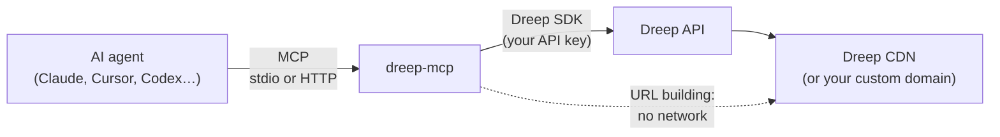

`dreep-mcp` is the official [Model Context Protocol](https://modelcontextprotocol.io)
server for Dreep. It lets Claude, Cursor, VS Code, Codex, Gemini and any other MCP client
upload, transform, convert, OCR and deliver media through your Dreep project.

Ask your agent things like:

> *"Upload `~/Desktop/launch/hero.png` to `marketing/2026` and give me a 1200px WebP and a 400px square thumbnail."*
>
> *"Pull the text out of this scanned invoice."*
>
> *"Convert `contract.docx` to PDF and give me a link that expires in an hour."*
>
> *"Cut the background out of `product.jpg` and show it on white."*

## How it works



1. Your MCP client starts `dreep-mcp` on your machine over stdio, or connects to one you
   host over streamable HTTP.
2. The agent sees 14 [tools](/mcp/tools) — 16 with deletes enabled — each with a typed JSON
   schema that lists every valid transform value, so it calls them correctly the first time.
3. Each tool calls the official Dreep SDK ([Node](/node-sdk/introduction) or
   [Python](/python-sdk/introduction)), which talks to the API with your key. Delivery and
   signed URLs are built locally, with no API call.
4. Results come back as structured JSON. Every asset carries the delivery `url` exactly as
   Dreep returned it, custom CDN domain included.

## Two runtimes, one set of tools

There are two native servers, one for Node and one for Python, so you only need the runtime
you already have. They expose the same tools: the Python server exports its tool names,
descriptions and input schemas to a generated contract that the Node server serves, and CI
fails if the two drift apart.

| Runner | Command | Needs |
| :--- | :--- | :--- |
| **npx** | `npx -y dreep-mcp` | Node 20+ |
| **uvx** | `uvx dreep-mcp` | [uv](https://docs.astral.sh/uv/) |
| **pip** | `pip install dreep-mcp`, then `dreep-mcp` | Python 3.10+ |

The [one known difference](/mcp/tools#differences-between-the-runtimes) comes from the Node
SDK.

## Quick start

<Steps>
  <Step title="Create an API key">
    On the **API Keys** page of your [Dreep dashboard](https://dreep.cloud). Add the URL
    Signing Secret too if you use signed folders.
  </Step>
  <Step title="Add the server to your client">
    Every client needs the same three things: a command (`npx`), its arguments
    (`-y dreep-mcp`), and your key in `DREEP_API_KEY`. See
    [Installation](/mcp/installation) for the exact file and format per client.

    ```json
    {
      "mcpServers": {
        "dreep": {
          "command": "npx",
          "args": ["-y", "dreep-mcp"],
          "env": { "DREEP_API_KEY": "drp_live_your_key" }
        }
      }
    }
    ```
  </Step>
  <Step title="Ask for something">
    Restart the client and the Dreep tools appear in its tool list. Ask it to upload a file
    and give you a thumbnail.
  </Step>
</Steps>

<Warning>
  Your API key can read, upload and delete everything in the project. It stays in the
  server's environment and is sent only to the Dreep API — never to the agent or the model.
  See [Security](/mcp/security).
</Warning>

## Where to go next

<CardGroup cols={2}>
  <Card title="Installation" icon="plug" href="/mcp/installation">
    Config for Claude, Cursor, VS Code, Windsurf, Codex, Gemini, Zed and the rest.
  </Card>
  <Card title="Tools" icon="wrench" href="/mcp/tools">
    What the agent can call, and what each tool returns.
  </Card>
  <Card title="Configuration" icon="sliders" href="/mcp/configuration">
    Environment variables, CLI flags and the HTTP transport.
  </Card>
  <Card title="Security" icon="shield-check" href="/mcp/security">
    Key handling, deletes, file scoping and signed URLs.
  </Card>
</CardGroup>
