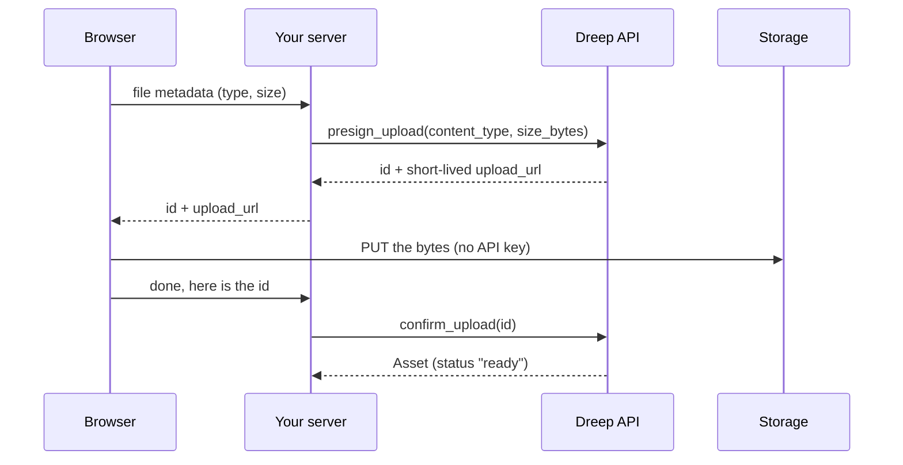

A presigned upload sends the bytes directly to storage instead of through the API. Use it
for large files, and whenever the bytes live somewhere your server can't stream from — a
browser, a mobile app.

The API key is never involved in the `PUT`, so the upload URL is safe to hand to a client.

## upload_presigned

Presign, stream the `PUT` and confirm, in one call. This is the path for large files on
your own server: the bytes are streamed from disk in 1 MB chunks and never held in memory.

```python
asset = client.upload_presigned(Path("video.mp4"), folder="uploads/2026")
```

```python
client.upload_presigned(
    file,
    *,
    filename=None,
    content_type=None,
    folder=None,
    key=None,
    folder_id=None,
    auto_create_folders=None,
    transform=None,
    preset_key=None,
    content_hash=None,
    timeout=NOT_GIVEN,
) -> Asset
```

Takes the same destination arguments as [`upload()`](/python-sdk/upload/upload-media), plus:

| Parameter | Type | Description |
| :--- | :--- | :--- |
| `content_hash` | `str` | The file's hex SHA-256. Lets Dreep skip the upload entirely if it already stores those bytes |

The source must be size-aware — a `Path`, `bytes`, or a seekable file object — because
storage is told the exact size up front. The confirm is retried while the bytes settle, so
the 409 the API answers in that window is handled for you.

## presign_upload

Start the flow yourself when the bytes are uploaded by someone else, typically a browser.

```python
upload = client.presign_upload(
    content_type="video/mp4",
    size_bytes=84_000_000,
    filename="launch.mp4",
    folder="uploads/2026",
)

upload.id          # "0f9c3f7a-…" — needed to confirm
upload.upload_url  # short-lived storage URL, hand this to the client
upload.already_exists  # True when content_hash matched stored content
```

```python
client.presign_upload(
    *,
    content_type,
    size_bytes,
    filename=None,
    folder=None,
    key=None,
    folder_id=None,
    auto_create_folders=None,
    format=None,
    preset_key=None,
    content_hash=None,
    timeout=NOT_GIVEN,
) -> PresignedUpload
```

| Parameter | Type | Description |
| :--- | :--- | :--- |
| `content_type` | `str` | **Required.** MIME type. The `PUT` must send exactly this |
| `size_bytes` | `int` | **Required.** Exact size. The `PUT` must match it |
| `filename` | `str` | Name to store it under |
| `format` | `str` | Convert on confirm |
| `content_hash` | `str` | Hex SHA-256 of the content, to skip bytes Dreep already has |

<Warning>
  The client must `PUT` with exactly the `content_type` and byte count that were presigned.
  Storage checks both and rejects a mismatch.
</Warning>

## The browser flow



```python
# 1. On your server
upload = client.presign_upload(content_type="video/mp4", size_bytes=84_000_000)
#    send upload.id and upload.upload_url to the browser

# 2. The browser PUTs the bytes to upload.upload_url

# 3. Back on your server
asset = client.confirm_upload(upload.id)
```

[`confirm_upload()`](/python-sdk/upload/confirm-upload) is what turns the stored bytes into
an asset. Until it runs, the upload is not listed by
[`list_media()`](/python-sdk/media/list-media).

## Errors

| Error | Cause |
| :--- | :--- |
| `DreepValidationError` | `size_bytes` exceeds the plan's per-file limit |
| `DreepLimitError` | Storage quota reached |
| `ValueError` | The source isn't size-aware, so `upload_presigned()` can't presign it |
